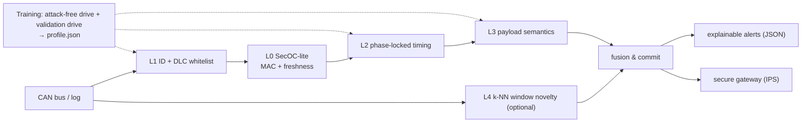
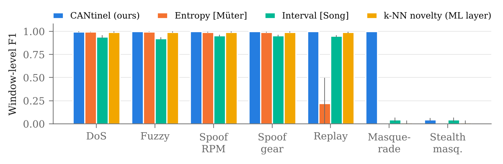
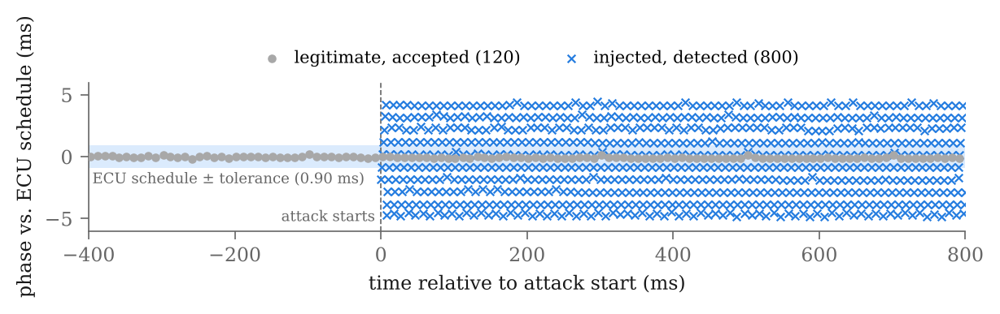

# CANtinel

**An open, explainable intrusion detection & prevention system for in-vehicle CAN networks.**

CANtinel learns how a vehicle's ECUs talk from attack-free traffic, with **no DBC file and no labelled attacks**. It then flags injected, replayed, fuzzed, flooded and masqueraded frames, and every alert says *why*:

```
0x43F  TIMING_EARLY     arrived 3.46 ms ahead of the ECU's schedule (period 10.00 ms, tolerance 0.90 ms)
0x4B0  CHECKSUM_FAIL    byte 7: crc8 checksum 0x64 != expected 0xBA
0x316  RANGE_VIOLATION  byte 3: value 93 outside learned range [10, 61]
0x000  UNKNOWN_ID       ID 0x000 is not part of this vehicle's communication matrix (... priority-flood DoS)
```

It also ships a **secure gateway** (in-line prevention) and **SecOC-lite**, an AUTOSAR-SecOC-style message authentication layer (24-bit AES-CMAC + 8-bit freshness). SecOC-lite stops the attack that no anomaly detector can see: a perfect, reverse-engineered masquerade.

> Built for the course **UCS762 Cybersecurity for Mobility Systems** (Thapar Institute of Engineering & Technology). The accompanying Springer LNCS paper is in [`paper/`](paper/).

---

## Why another CAN IDS?

| Need | Commercial IDPS (PlaxidityX, ETAS CycurIDS) | Cloud VSOC | IT IDS (Snort/Suricata) | Academic DL IDS | **CANtinel** |
|---|---|---|---|---|---|
| Open source / auditable | ✗ | ✗ | ✓ | partly | **✓** |
| Understands CAN timing & payload | ✓ | ✓ | ✗ | ✓ | **✓** |
| Works without OEM DBC files | not documented | not documented | – | ✓ | **✓** |
| No labelled attack data needed | not documented | not documented | ✗ | ✗ | **✓** |
| Explainable per-frame alerts | not documented | not documented | ✓ | ✗ | **✓** |
| In-line prevention | ✓ | ✗ | partly | ✗ | **✓** |
| Message authentication (SecOC) | not documented | ✗ | ✗ | ✗ | **✓** |
| Free for research / fleets / start-ups | ✗ | ✗ | ✓ | ✓ | **✓** |

## How it works



| Layer | What it learns / checks |
|---|---|
| **L1 Spec** | ID whitelist and DLC per ID; flags unknown IDs and priority floods |
| **L2 Phase-locked timing** | Locks onto every ECU's transmission *schedule* with an asymmetric PLL. A genuine ECU can be delayed but is never early, so the tolerance only needs to cover jitter (0.25–1.05 ms for 10 ms messages). The layer is flood-aware and re-synchronises when an ECU's phase shifts. |
| **L3 Payload semantics** | Discovers per byte: checksum (XOR / SUM / CRC-8 SAE-J1850), rolling counters, enums plus their state-transition graph (P→R, D2→D3…), numeric ranges and rate limits |
| **Fusion** | Only frames accepted by *all* layers update the timing anchor and payload reference, so injected frames can't poison the reference. Self-tunes on a validation drive. |
| **L4 k-NN novelty** | Unsupervised 100 ms window features (entropy, bus load, Hamming distance, …) |
| **Gateway** | Forwards a frame only if it's whitelisted, raised no alert and passes a per-ID token bucket |
| **SecOC-lite** | `payload ‖ FV(8 bit) ‖ CMAC(24 bit)`, with freshness reconstruction, replay rejection and MAC brute-force alerts |

## Results (5 simulated vehicles, mean)

Reproduce them with `cantinel benchmark` (about 4 minutes).

| Attack | Interval baseline F1 | **CANtinel F1** |
|---|---|---|
| DoS (0x000 every 0.3 ms) | 0.998 | **1.000** |
| Fuzzy (random ID/data, 0.5 ms) | 0.021 | **1.000** |
| Spoof RPM (1 ms) | 0.952 | **0.991** |
| Spoof gear (1 ms) | 0.952 | **0.964** |
| Replay | 0.353 | **1.000** |
| Masquerade (victim bus-off) | 0.000 | **0.999** |
| Stealth masquerade (counter + CRC forged) | 0.000 | 0.004 → **stopped by SecOC-lite (0 / 2,000 accepted)** |
| False-positive rate on clean traffic | 2.4e-4 | **2.3e-6** |

* Throughput: **~196,000 frames/s** on one core in pure Python, more than 40× a fully loaded 500 kbit/s bus.
* Gateway: blocks 96.4–100 % of every detectable attack and forwards ≥ 99.2 % of genuine frames.
* SecOC-lite: 0 of 500 replays, 0 of 3,000 forgeries and 0 of 200,000 brute-force guesses accepted; 100 % of genuine PDUs accepted, even with 10 % frame loss.




Full tables: [`results/tables.md`](results/tables.md) · raw numbers: [`results/results.json`](results/results.json)

## Quick start

```bash
git clone https://github.com/AtishayKashyap/cantinel.git
cd cantinel
python -m venv .venv && source .venv/bin/activate      # Windows: .venv\Scripts\activate
pip install -e ".[dev]"                                  # numpy, scikit-learn, cryptography, matplotlib, python-can, pytest

pytest -q                                                # 21 tests
python examples/quickstart.py                            # learn -> detect -> block -> authenticate
cantinel demo --attack masquerade                        # live classroom demo on a virtual CAN bus
```

### Command line

```bash
# 1. generate labelled captures (or use your own logs)
cantinel simulate --duration 300 --seed 1 -o data/train.csv
cantinel simulate --duration 120 --seed 2 -o data/validation.csv
cantinel simulate --duration 60  --seed 3 --attack masquerade -o data/attack.csv

# 2. learn the vehicle profile (human-readable JSON)
cantinel train -i data/train.csv -v data/validation.csv -o profile.json

# 3. detect (prints precision/recall when labels exist, writes JSON-lines alerts)
cantinel detect -p profile.json -i data/attack.csv --alerts alerts.jsonl

# 4. prevent: run the capture through the secure gateway
cantinel gateway -p profile.json -i data/attack.csv -o forwarded.csv

# 5. authentication experiment and full benchmark
cantinel secoc-demo
cantinel benchmark --seeds 1 2 3 4 5
```

Attack types: `dos`, `fuzzy`, `spoof_rpm`, `spoof_gear`, `replay`, `masquerade`, `stealth_masquerade`.

### Real data and real buses

* **HCRL Car-Hacking dataset** (`DoS_dataset.csv`, `gear_dataset.csv`, `normal_run_data.txt`, …): pass the files straight to `train` / `detect`. The format is detected automatically and the T/R flags are used as labels.
* **candump logs** (`candump -l can0`) are supported too.
* **Live SocketCAN** (Linux):
  ```bash
  sudo modprobe vcan && sudo ip link add dev vcan0 type vcan && sudo ip link set up vcan0
  cantinel live -p profile.json --interface socketcan --channel vcan0
  # in another terminal, e.g.:  canplayer -I your.log vcan0=can0
  ```
  Any interface supported by python-can (PCAN, Vector, Kvaser, slcan…) works through `--interface`.

## Project layout

```
cantinel/
  vehicle.py        driving scenario + 24-message catalogue (8 ECUs)
  simulator.py      discrete-event CAN bus: arbitration, mailboxes, drift, 7 attack types
  detectors/
    spec.py         L1 whitelist
    timing.py       L2 phase-locked timing
    payload.py      L3 payload semantics (checksums, counters, enums, transitions, ranges)
    ml.py           L4 k-NN / Isolation-Forest window novelty
    baselines.py    interval (Song et al. 2016) and entropy (Müter & Asaj 2011) baselines
  engine.py         profile training, self-tuning, fusion
  gateway.py        secure gateway (IPS)
  secoc.py          SecOC-lite (AES-128-CMAC, freshness), auth layer
  io.py             CSV / HCRL / candump readers
  experiments.py    benchmark + LaTeX tables, figures.py: plots
  live.py, cli.py   live monitor, demo, CLI
tests/              pytest suite
paper/              Springer LNCS article (Overleaf-ready)
results/, docs/     benchmark output and figures
```

## Limitations

* Results come from a realistic simulator, not a production vehicle. Validating on HCRL, ROAD and a hardware test bench is the next step.
* A spoofed value that is a *legal successor* of the current state (e.g. "R" while standing in D1) can sometimes capture the timing slot, which is why spoof-gear F1 is 0.96.
* A stealth masquerade (correct period, counter and CRC) is undetectable by any anomaly IDS. Stopping it needs authentication (SecOC-lite), which in turn needs key provisioning and ECU support.
* This is a Python prototype; an embedded deployment would port L1–L3 to C.

## Citation

```bibtex
@misc{cantinel2026,
  title  = {CANtinel: Verifying In-Vehicle CAN Security Problems and Overcoming the Limits of
            Market Intrusion Detection Tools with an Open, Explainable IDS/IPS},
  author = {Atishay Kashyap},
  year   = {2026},
  note   = {UCS762 Cybersecurity for Mobility Systems, Thapar Institute of Engineering and Technology},
  url    = {https://github.com/AtishayKashyap/cantinel}
}
```

MIT License. For research and education. Never inject frames into a vehicle on a public road.
